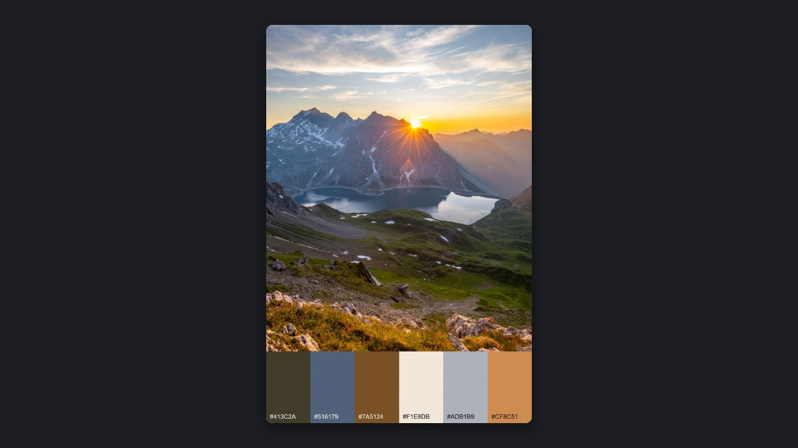

# Free Affinity scripts by Senyi Labs

Three free scripts for [Affinity](https://www.affinity.studio) 3.3 or later (Settings → Scripting → Enable Affinity
Scripting).

| Script | What it does |
|---|---|
| **Photo Palette** | Select a photo's pixel layer and run it: the photo's main colours appear as swatches with hex codes along its bottom edge, in a group you can move or delete. Choose 2–12 colours, and whether each swatch's width shows how much of the photo it covers. |
| **Watermark** | Adds text such as "© Your Name" in a corner, in the middle, or repeated at an angle across the whole photo (whole copies only, or cut off at the edges), to this document or every open one at once. Pick the font, colour, size and opacity. Type `{file}` to put each photo's file name in it, such as the camera's photo number. |
| **Contact Sheet** | Pick any photo in a folder: a new A4 page gets every photo in that folder in a grid, with the file names underneath, including Affinity files (.af, .afphoto) and camera RAW files. For proofs, picks and printing. |

## Install

- **With [Script Manager for Affinity](https://github.com/JiriKrblich/Affinity-script-manager):** Community →
  Repositories → add `https://github.com/senyilabs/affinity-scripts`, then click Install.
- **By hand:** open a file in `dist/`, copy it, and in Affinity choose Window → Scripting → Script Editor → New
  Script, paste, and Save As.

## Paid scripts

Photoshop features Affinity doesn't have, as scripts, at [senyilabs.com](https://senyilabs.com):
[Content-Aware Move](https://senyilabs.com/content-aware-move) moves an object and fills the gap it leaves,
[Match Color](https://senyilabs.com/match-color) gives a photo the colours and light of another one,
[Puppet Warp](https://senyilabs.com/puppet-warp) bends parts of a photo with pins, and
[Content-Aware Scale](https://senyilabs.com/content-aware-scale) resizes photos without squashing people or buildings.

## For developers

Each script is a pure module in `src/` (tested with `npm test`) plus its Affinity side in `src/*.affinity.js`;
`npm run build` joins them into the single files in `dist/` and writes `registry.json`.

Affinity is a trademark of Canva. These scripts are made by Senyi Labs and aren't made or endorsed by Canva.
Example photos: Unsplash.
